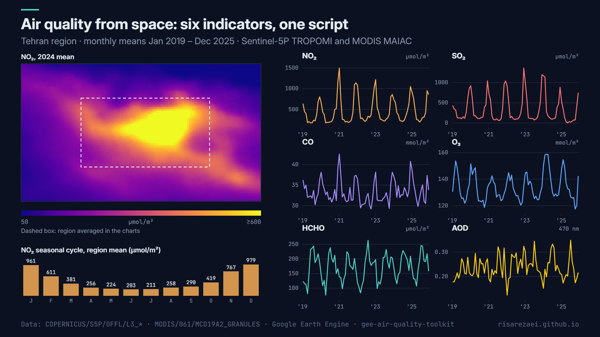

# Air-Quality Toolkit (Sentinel-5P + MODIS)

Monthly **air-quality indicators from satellites** for a city or region and for any set of monitoring stations: **NO₂, SO₂, CO, O₃, HCHO** from Sentinel-5P TROPOMI and **aerosol optical depth (AOD)** from MODIS MAIAC, all from one script and in one tidy CSV.

Example output for Tehran with the default settings, January 2019 to December 2025.

## What the script does

- Builds **monthly mean images** for each selected pollutant over the analysis period.
- Averages them over the **region** and inside a buffer around each **station**.
- Prints one chart per pollutant (region and stations together) and adds a **period-mean map** for each.
- Exports a **long-format CSV**: `pollutant, unit, site, month, value, n_images`. It loads straight into pandas, R or Excel pivot tables.
- Optionally exports **every monthly map as a GeoTIFF**. The month list is built in the browser, so no slow server round trip is needed.

For a single pollutant at many stations with daily values, see [gee-no2-station-tracker](https://github.com/RisaRezaei/gee-no2-station-tracker).

## Quick start

1. Open the [Earth Engine Code Editor](https://code.earthengine.google.com).
2. Paste [`air_quality_toolkit.js`](air_quality_toolkit.js) into a new script.
3. Edit `region`, `stations`, the dates and the list of `pollutants` in `CONFIG`.
4. Press **Run**, then start the exports from the **Tasks** tab.

## Configuration

| Parameter | Default | Description |
|---|---|---|
| `region` | Tehran rectangle | Area for the regional mean and the maps |
| `stations` | 3 example points | `[name, lon, lat]` list; `[]` for region only |
| `stationBufferMeters` | `2000` | Radius averaged around each station |
| `start` / `end` | `2019-01-01` / `2026-01-01` | Period (end is exclusive) |
| `pollutants` | all six | Any of `NO2`, `SO2`, `CO`, `O3`, `HCHO`, `AOD` |
| `exportTable` | `true` | Export the monthly CSV |
| `exportMonthlyMaps` | `false` | One GeoTIFF per pollutant and month |

## Products and units

| Key | Dataset | Band | Unit in outputs |
|---|---|---|---|
| NO2 | `COPERNICUS/S5P/OFFL/L3_NO2` | tropospheric NO₂ column | µmol/m² |
| SO2 | `COPERNICUS/S5P/OFFL/L3_SO2` | SO₂ column | µmol/m² |
| CO | `COPERNICUS/S5P/OFFL/L3_CO` | CO column | mmol/m² |
| O3 | `COPERNICUS/S5P/OFFL/L3_O3` | O₃ column | mmol/m² |
| HCHO | `COPERNICUS/S5P/OFFL/L3_HCHO` | tropospheric HCHO column | µmol/m² |
| AOD | `MODIS/061/MCD19A2_GRANULES` | Optical_Depth_047 | unitless |

## Notes

- Satellite columns are **not** surface concentrations. They track spatial patterns and trends well, but converting them to µg/m³ needs a model or a local regression against ground monitors.
- SO₂ and HCHO are noisy over clean areas, and monthly means can be slightly negative. Prefer longer averages or larger regions for these two.
- Sentinel-5P data start in mid-2018 (NO₂ OFFL from 2018-06, others from 2018-07); MAIAC AOD starts in 2000.
- `n_images` gives the number of images in each monthly mean, so you can drop months with poor coverage.

## Cite this tool

Abbasalizadehrezaei, P. (2026). *Air-Quality Toolkit (Sentinel-5P and MODIS MAIAC)* (Version 1.0.0) [Software]. Zenodo. https://doi.org/10.5281/zenodo.23646371

GitHub also offers a ready-made citation under **Cite this repository** (from [CITATION.cff](CITATION.cff)).

## Author

**Parisa Abbasalizadehrezaei** · [risarezaei.github.io](https://risarezaei.github.io)

Released under the [MIT License](LICENSE).
